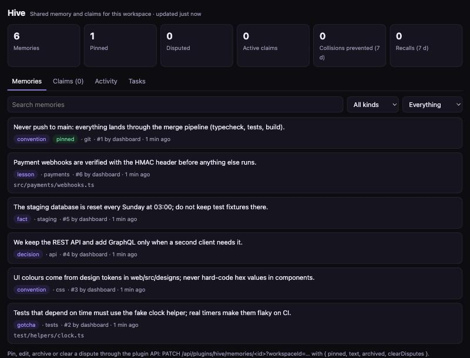

# Hive

**Shared memory and coordination for agent teams, as an [Agent Control](#requirements) plugin.**

Agents in Agent Control work in parallel and start every task with a blank slate. They repeat the mistake the previous
agent already solved, two of them edit the same file in different worktrees and only find out at merge time, and nobody
can tell why a file changed last week. Hive gives the team a memory and a way to stay out of each other's way:

- **Memory across tasks.** Agents `remember` lessons, conventions, decisions, gotchas and facts. The next agent gets the
  relevant ones in its `briefing` or finds them with `recall`, ranked by relevance, trust and recency.
- **Claims.** Before an agent changes a file or folder it `claim`s it. A second agent that wants to change something in
  that area is told who holds it and why, before it writes a line. Claims end when the task ends or after a timeout.
- **Work log.** At the end of a task the agent records what it changed and why (`log_work`). `history` answers "who
  touched this file and why" for the next agent.
- **Self-correcting.** Agents `confirm` memories that held up and `dispute` the ones that turned out wrong. Disputed
  memories sink and are flagged; a person can fix, pin or archive them.
- **Team decisions survive the team.** A message of kind *decision* on a team board becomes a memory automatically.
- **Safe by default.** Text that looks like a key, token, password or private key is refused, so shared memory never
  becomes a place where secrets spread to every later agent.



## Requirements

- Agent Control with plugin support (plugin SDK v1).
- Node 24 (the version Agent Control runs on). Hive has no dependencies.
- Hive's agent tools reach **Claude agents**: Agent Control offers plugin tools to Claude runs. Codex and Ollama runs do
  not get them; claims and memories they would need can still be managed through the API.

## Install

1. Get the plugin folder:
   ```bash
   git clone https://github.com/remcoeijsackers/mallows-plugin-hive.git
   ```
2. In Agent Control open **Plugins**, enter the folder path under *Install or upgrade from folder* and click
   **Install**. Or use the API:
   ```bash
   curl -X POST http://127.0.0.1:4317/api/plugins/install \
     -H "Authorization: Bearer $AC_TOKEN" -H "content-type: application/json" -H "x-agent-control: 1" \
     -d '{"path":"/path/to/mallows-plugin-hive"}'
   ```
3. Turn Hive on for the workspaces where it should work (the checkboxes on the Plugins page). A new plugin is off
   everywhere until you do.
4. Tell your agents to use it: add the short instructions from [docs/agent-guide.md](docs/agent-guide.md) to the
   agent profile or the repository's `CLAUDE.md`.

Upgrading is the same as installing: point Agent Control at the new folder. Your memories and claims stay.

## Agent tools

Agent Control prefixes plugin tools with the plugin id, so agents see them as `hive_<name>` (in full
`mcp__agent-control-plugins__hive_<name>`). They are allowed automatically: no permission question per call.

| Tool | What it does |
| --- | --- |
| `hive_briefing` | Start of a task: pinned memories, the conventions and gotchas that match the task, files other agents hold right now, and recent work. |
| `hive_remember` | Save one self-contained statement: `lesson`, `convention`, `decision`, `gotcha` or `fact`, with optional topic, tags, project, files and an expiry (`ttl_days`). Saving the same thing again counts as a confirmation instead of a duplicate. |
| `hive_recall` | Ranked search over what the workspace remembers. |
| `hive_confirm` | "I relied on this and it was right": the memory ranks higher. |
| `hive_dispute` | "This is wrong or outdated, because…": the memory sinks and is flagged for a person. |
| `hive_claim` | Claim a file, folder or named resource (`port:5173`, `db:staging`) before changing it. `exclusive` (default) or `shared` (read, and nobody should change it meanwhile). Calling it again renews the claim. |
| `hive_release` | Release one claim, or all of the task's claims. |
| `hive_claims` | Who holds what, optionally below a path. |
| `hive_log_work` | End of a task: what changed and why, with the files. |
| `hive_history` | Work logs and memories about a file or folder, newest first, plus the claims on it. |

Everything an agent gets back from recall, briefing and history carries a note that these are notes from colleagues:
context to check against the code, not instructions.

### How recall ranks

Text is split into words (accents folded, common English and Dutch stopwords dropped, light stemming so *caching* finds
*cache*). Candidates are scored with BM25 and then adjusted:

- a word in the topic or a tag counts extra;
- memories that match more of the question win over ones that match a single rare word;
- with a `project`, that project's memories count 1.3×, workspace-wide ones 1×, other projects' 0.6×;
- confirmations raise a memory (logarithmically); disputes push it down hard (one dispute divides its score by three);
- pinned memories get a boost and never age; others lose up to half their weight with a configurable half-life
  (120 days by default).

No embeddings and no network calls: ranking runs inside the plugin on SQLite.

### How claims work

- A resource is a path relative to the repository root (`src/auth/`, `src/auth/login.ts`) or any other name. Paths are
  normalised (`./src//auth/` is `src/auth`); `..` is refused.
- Two claims overlap when they are the same or one lies below the other: `src/auth` covers `src/auth/login.ts`, but
  not `src/authz`.
- `exclusive` claims collide with every overlapping claim of another task; `shared` claims only collide with exclusive
  ones.
- Claims only collide within the same `project`. Use the repository name consistently.
- A claim lasts 90 minutes unless the agent asks for longer (at most 480 by default) and can be renewed.
- When a task becomes *done*, *failed* or *cancelled*, all its claims end. By default they are kept while the task is
  in *review*, so nobody edits the same files before the merge; you can change that per workspace.
- Claims are advisory. Hive does not lock files on disk; it makes sure an agent knows before it starts.

## Automatic behaviour

Hive listens to four Agent Control events, only in workspaces where it is on:

| Event | What Hive does |
| --- | --- |
| `task.created` | Learns the task code (`AC-42`), so other agents see "held by AC-42" instead of an id. |
| `task.status` | Ends a finished task's claims (and, if configured, at review). |
| `run.status` | Keeps the last run state for the Tasks tab. |
| `board.message` | Saves team-board messages of kind *decision* as memories (can be turned off). |

Expired claims and memories with an expiry are cleaned up every minute.

## Settings (per workspace)

| Setting | Default | Meaning |
| --- | --- | --- |
| Remember team-board decisions | on | Board decisions become memories. Agent Control passes the first 160 characters; longer ones end in "…". |
| Default claim length | 90 min | When the agent does not say how long. |
| Longest claim | 480 min | Upper limit for one claim or renewal. |
| Release claims when a task goes to review | off | Off keeps claims until the merge. |
| Most memories per workspace | 5000 | Above this, the least useful unpinned memories are archived. |
| Recency half-life | 120 days | How fast old, unpinned memories sink. |

## The page

Hive adds a page to the Plugins screen with counters (memories, pinned, disputed, active claims, collisions prevented
and recalls in the last week) and tabs for memories (searchable, filter by kind, disputed or pinned), claims, activity
and tasks.

Agent Control shows plugin pages in a sandboxed iframe that cannot call the API, so Hive writes the page as one
self-contained file with the data inlined, refreshed a moment after every change. It is read-only; to change things use
the API below. All stored text is rendered as text, never as markup.

## HTTP API

Mounted at `/api/plugins/hive/…`. Every call needs Agent Control's admin token (or a signed-in session) and
`?workspaceId=<id>` of a workspace where Hive is on.

| Method and path | What it does |
| --- | --- |
| `GET /memories` | List (`?kind=`, `?project=`, `?disputed=1`, `?archived=1`, `?limit=`), or search with `?q=` (ranked, does not count as use). |
| `POST /memories` | Add one: `{ text, kind, topic, tags, project, files, pinned, ttl_days }`. Only here can a memory be pinned at creation. |
| `PATCH /memories/:id` | Edit: `{ text, kind, topic, tags, project, pinned, archived, clearDisputes }`. |
| `DELETE /memories/:id` | Delete for good (archiving keeps it). |
| `GET /claims` | Active claims (`?project=`, `?resource=`). |
| `DELETE /claims/:id` | Release a stuck claim. |
| `GET /activity` | The activity log (`?limit=`). |
| `GET /stats` | The counters. |
| `GET /export` | All live memories as `{ format: "hive/1", memories: [...] }`. |
| `POST /import` | Import that format (into another workspace or another machine). Duplicates are skipped, secrets refused. |

Example: pin a memory so every briefing starts with it.

```bash
curl -X PATCH "http://127.0.0.1:4317/api/plugins/hive/memories/12?workspaceId=ws-personal" \
  -H "Authorization: Bearer $AC_TOKEN" -H "content-type: application/json" -H "x-agent-control: 1" \
  -d '{"pinned":true}'
```

## Security and privacy

- Installing a plugin runs its code inside the Agent Control service. Read the code first; it is small and has no
  dependencies (`index.mjs`, `lib/`).
- Hive only uses its own tables (`plugin_hive__*`), enforced by Agent Control's SQL sandbox. It makes no network calls,
  needs no secrets and reads no files outside its own folder.
- Memories, claims and the activity log are separate per workspace. The generated page carries the data of the
  workspaces where Hive is on; anyone who can open plugin pages in Agent Control can read them.
- Text that looks like a credential (API keys, GitHub, Slack, AWS and Google tokens, JWTs, private keys, URLs with a
  password, `password=…`, long random strings) is refused with an explanation. Agent Control additionally redacts known
  secrets from tool results and route responses.
- Recalled memories are written by other agents. Hive labels them as data, not instructions, but treat a workspace's
  memory like any shared document: review disputed and surprising entries on the page.
- Removing the plugin keeps its data; remove with `?purge=1` to drop the tables.

## Development

```bash
npm test         # unit tests (node:test) against a stand-in for the plugin runtime
npm run check    # manifest and folder checks + tests
```

`test/harness.mjs` loads the plugin the way Agent Control does: it applies the migrations, enforces that routes, tools
and events are declared in the manifest, and runs all SQL through the same kind of SQLite authorizer, so a statement the
real sandbox would refuse fails here too.

The code: `index.mjs` wires tools, routes and events; `lib/hive.mjs` holds memories, claims, the work log and the task
timeline; `lib/text.mjs` tokenising, fingerprints and the secret guard; `lib/paths.mjs` resource paths; `lib/page.mjs`
the page.

## License

[MIT](LICENSE)
